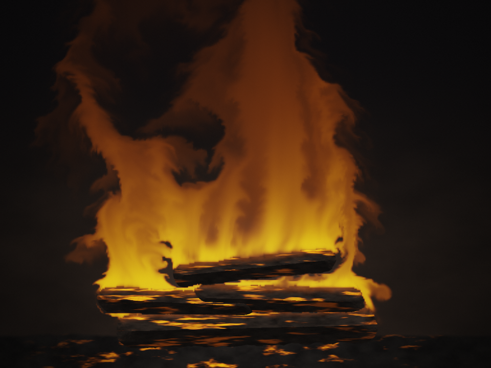

# fire

**[Live demo →](https://raggedr.github.io/fire/)**



A real-time fire simulation in the browser: buoyancy-driven incompressible
Navier–Stokes with vorticity confinement, a two-species combustion model, and
blackbody emission. Single self-contained WebGL2 page, no dependencies.

Open `index.html` in any browser with WebGL2 (`EXT_color_buffer_float`).
Sliders on the right expose every physical parameter; `space` pauses, `r` resets.

## The model

Velocity `u`, temperature `T`, fuel mass fraction `Y`, soot `S`, on a 384×288 grid:

```
∂u/∂t = −(u·∇)u − ∇p + f_buoy + f_conf + f_turb ,   ∇·u = 0
∂T/∂t = −(u·∇)T + q·ω̇ − c_T·T⁴          radiative loss (Stefan–Boltzmann)
∂Y/∂t = −(u·∇)Y + ṁ_pyro − ω̇            pyrolysis off the logs, then burning
∂S/∂t = −(u·∇)S + y_s·ω̇ − λ_S·S         soot production and turbulent dilution
ω̇     = k·Y·H(T)                        reaction rate, H a softened ignition step
f_buoy = (β(T − T_amb) − α·S) ẑ          Boussinesq: hot rises, soot weighs down
f_conf = ε·(N × ω),  N = ∇|ω| / (‖∇|ω|‖ + δ)
```

Solver, per frame: semi-Lagrangian advection of `u` then of `(T,Y,S)`;
chemistry and sources; buoyancy and turbulence forcing; curl and vorticity
confinement; divergence; 40 Jacobi iterations for pressure; gradient
subtraction. All fields are `half` textures — velocity is stored in uv-units
per second so magnitudes stay near 1, where fp16 has mantissa to spare.

Boundaries: chimney outflow (`p = 0`) along the top, room-air inlets (`p = 0`)
on the side walls below `OPEN_Y`, no-flux elsewhere, Neumann on the log
surfaces. The logs are a signed distance field of four capsules, evaluated
analytically at render resolution so the silhouette stays sharp.

Rendering maps `T` onto the Planckian locus (Tanner Helland's piecewise fit),
weights it by `T^2.6`, attenuates through soot, adds a thresholded bloom, and
tonemaps with the ACES filmic approximation.

## Three bugs worth remembering

1. **Unnormalised fbm.** Octave amplitudes ½+¼+⅛+¹⁄₁₆ sum to 0.9375, so `fbm()`
   had mean 0.469 and `fbm() − 0.5` was a constant wind, not turbulence. The
   plume drifted steadily off-frame. Normalise by the amplitude sum.

2. **Vorticity confinement blowing up.** `N = g/(|g| + 1e-7)` returns a unit
   vector even where the curl is locally flat, so the term injected direction
   noise everywhere. Confinement is anti-dissipative and unbounded: it drove
   |v|max to 87 and built a recirculation that drowned the fire. Fixed with a
   soft normalisation (`δ = 2e-3`) plus a hard cap on the force; ε must also
   stay ≲ 20, verified by measuring downward mass flux over 120 s.

3. **A sealed domain.** With no-flux on every boundary but the top, `∇·u = 0`
   forces zero net flux through the chimney — everything that rises must come
   back down inside the box. Hence the side inlets.

## Headless driving

The page exposes `window.fire` so a driver can step it deterministically,
independent of `requestAnimationFrame` throttling:

```js
window.fire.paused = true;
window.fire.reset();
window.fire.run(10);          // advance 10 simulated seconds at dt = 1/60
window.fire.stats();          // {Tmax, Ymax, Smax, hotFrac, flameTop, flameWidth, vyUp, vyDown, vyMax}
Object.assign(window.fire.P, {buoy: 4, cool: 6});
```

`stats()` is what the parameters above were tuned against — flame height,
width and sustained hot fraction over 120 s runs, rather than by eye.
